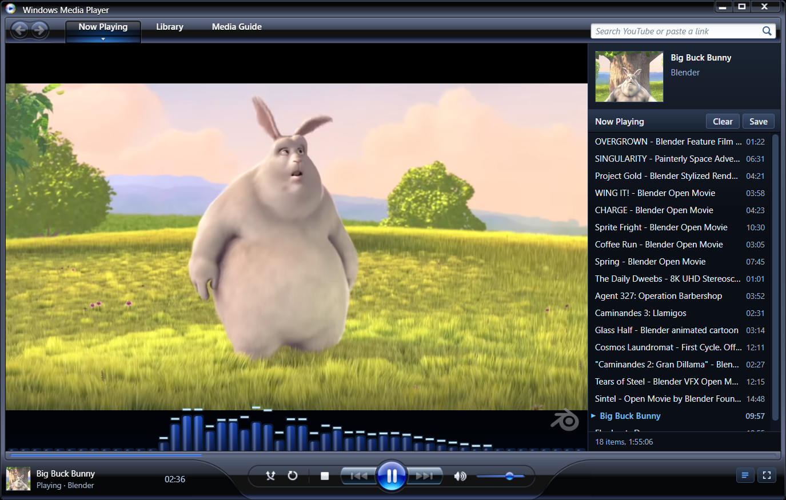

# WMP YouTube Player

A desktop YouTube player for Windows that looks and works like **Windows Media Player 11**.



## Features

- WMP11's full-mode window, rebuilt from the original skin: title bar, tabs, transport orb, seek bar, volume, compact mode below 640px
- Plays any YouTube video or playlist: paste a link into the search box, drop it on the window, or press Ctrl+V
- **Media Guide** tab with youtube.com built in: click any video to play it in the player
- Now Playing list, saved playlists, Recently Played, shuffle and repeat
- Visualizer over the video, built-in ad blocking, captions toggle, Color Chooser
- Full screen, media keys and taskbar thumbnail buttons

Playback goes through the real youtube.com watch page, so videos that block embedding (most music videos) still play.

## Install

Open the [`installer`](installer) folder and download one of these files:

- **WMP-YouTube-Player-Setup.exe** — recommended; installs the app and creates shortcuts.
- **WMP-YouTube-Player-Portable.exe** — runs directly without installation.

You can also download the same files from the [latest release](https://github.com/alex-rogo/WMP11-Youtube-Player/releases/latest).

## Build from source

The WMP artwork isn't in the source code; you extract it from your own copy of the WMP11 installer.

You need Windows, [Node.js](https://nodejs.org) 20+ and [Python](https://www.python.org) 3 with `pip install pefile pillow`.

1. Download Microsoft's **Windows Media Player 11 for Windows XP** installer (`wmp11-windowsxp-x86-enu.exe`).
2. Extract the artwork. The script checks that the installer is Microsoft-signed and doesn't run it.
   ```
   python tools/extract_wmp11.py path\to\wmp11-windowsxp-x86-enu.exe
   ```
3. Build the skin and run the app:
   ```
   cd app
   npm install
   npm run skin
   npm start
   ```
4. To build an installer and a portable `.exe` in `app/dist/`, run `npm run dist`.

## Notes

- Not affiliated with or endorsed by Microsoft or YouTube. Windows Media Player artwork is © Microsoft.
- The screenshot shows *Big Buck Bunny* (c) Blender Foundation, [CC BY 3.0](https://creativecommons.org/licenses/by/3.0/).
